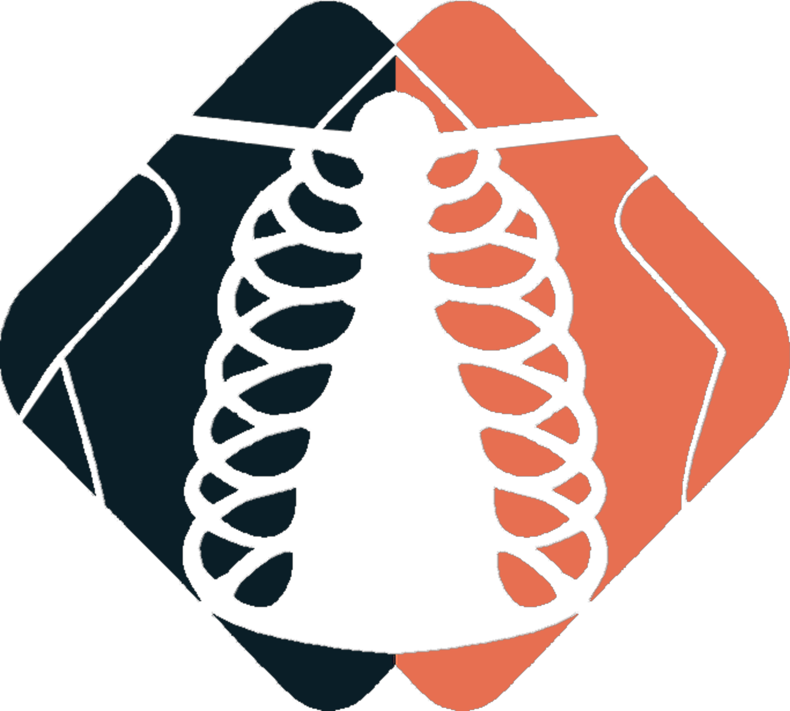
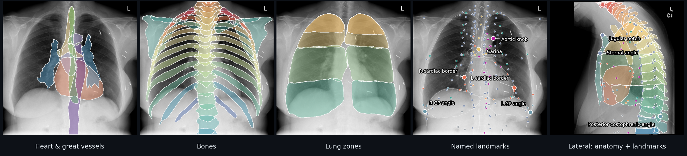
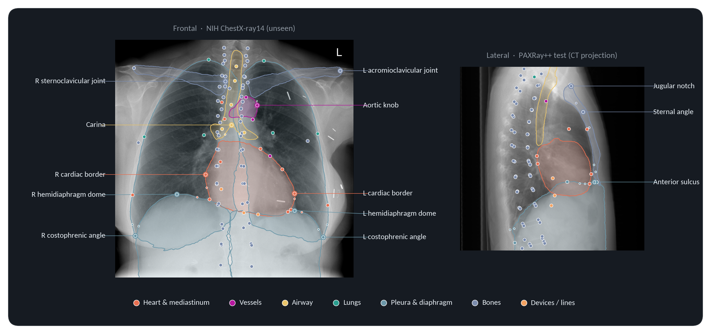

<p align="center">
<a href=https://arxiv.org/abs/2306.03934></a>
<a href=https://pepy.tech/project/cxas></a>
<a href="https://drive.google.com/drive/folders/1AEJAaPTxVMx9iofY4J4f2x5gpJqE61I2?usp=sharing"></a>
<a href="https://zenodo.org/records/16920313"></a>
<a href=https://huggingface.co/spaces/cmseibold/cxas-demo></a>
</p>

# Chest X-Ray Anatomy Segmentation (CXAS)

CXAS finds the anatomy in chest X-rays. Give it a radiograph, frontal or lateral, and it outlines up to 187
structures (lungs and lung zones, heart chambers, vessels, every rib and vertebra, ...), places 132 named
anatomical landmarks (the carina, the cardiac borders, the costophrenic angles, ...) and measures things like the
cardiothoracic ratio. Results come out as images, arrays, JSON, or DICOM objects that PACS viewers and the
[Imaging Data Commons](https://portal.imaging.datacommons.cancer.gov/) can display.



<sub>Frontal: NIH ChestX-ray14 (NIH Clinical Center). Lateral: RIDER Pilot collection, The Cancer Imaging Archive,
via the Imaging Data Commons (CC BY 4.0).</sub>

Try it in the browser: [Hugging Face demo](https://huggingface.co/spaces/cmseibold/cxas-demo).

**New in 0.1:** named landmarks, new segmentation models for frontal and lateral X-rays, DICOM output that DICOM
tools can actually use, and Docker images for standard servers. [What changed](#whats-new-in-01).

## Quick start

```bash
pip install cxas
```

```bash
# outline the anatomy of every image in a folder (PNG masks per structure)
cxas_segment -i images/ -o results/ -m M2F_anatomy_v2

# measure the cardiothoracic ratio
cxas_feat_extract -i images/ -o results/ -f CTR

# DICOM in, DICOM out: segmentation + landmarks for every radiograph in a folder
cxas_idc -i dicom/ -o results/
```

Model weights download automatically the first time they are needed (about 1 GB for the new models and the
landmarks, 0.8 GB for the UNet). A GPU is used when one is available; everything also runs on a CPU.

In Python:

```python
import numpy as np
from PIL import Image
from cxas import CXAS
from cxas.landmarks import LandmarkDetector

model = CXAS(model_name="M2F_anatomy_v2", gpus="0")         # gpus="cpu" without a GPU
pred = model.process_file("chest_xray.png")                 # .png, .jpg or .dcm
masks = pred["segmentation_preds"][0]                       # one mask per structure

image = np.asarray(Image.open("chest_xray.png").convert("L"))
landmarks = LandmarkDetector(device="cuda:0").predict(image, view="frontal")
# [{"class": "tracheal bifurcation", "landmark": "carina", "x": 812.4, "y": 690.1, "confidence": 0.93}, ...]
```

The notebooks in [`demos/`](demos) walk through the most common tasks:
[basic usage](demos/BasicUsage.ipynb), [folders of images](demos/ProcessDirectory.ipynb),
[feature extraction](demos/ExtractFeatures.ipynb), [visualising results](demos/VisualizingResults.ipynb) and
[registration](demos/Registration.ipynb).

## What CXAS gives you

| | What you get | Command | Python |
|---|---|---|---|
| [Anatomy segmentation](#anatomy-segmentation) | a mask for each of up to 187 structures | `cxas_segment` | `CXAS(...).process_file` |
| [Named landmarks](#named-anatomical-landmarks) | 132 named anatomical points | `cxas_idc` | `LandmarkDetector` |
| [Clinical measurements](#clinical-measurements) | cardiothoracic ratio, costophrenic angle, Cobb angle, areas, ... (in mm for DICOM) | `cxas_feat_extract`, `cxas_idc` | `extract_features_for_file`, `measure` |
| [Registration](#registration) | images aligned to a common reference, frontal and lateral | `cxas_register` | `Registrator` |
| [DICOM output](#dicom-in-dicom-out-imaging-data-commons-mhub) | DICOM SEG + Structured Report for viewers and the Imaging Data Commons | `cxas_idc` | |

## Anatomy segmentation

Two kinds of model are available. All commands and functions accept both (`-m` / `model_name`).

| Model | X-ray views | Structures | Masks |
|---|---|---|---|
| `UNet_ResNet50_default` (the default) | frontal | 159 | computed at 512 x 512, then resized to the image |
| `M2F_anatomy_v2` (new in 0.1) | frontal and lateral | 187 frontal, 177 lateral | computed at the image's own resolution |

**Which one to use?** For new work, `M2F_anatomy_v2`: its outlines are sharper, it handles lateral views, and it
holds up better on unusual images (busy portable films, a radiograph stored rotated). The UNet stays the default
so existing scripts keep giving the same results.

Both return the same 159 structures in the same order, so everything built on CXAS keeps working with either
model. The new frontal model also knows the head, the humeri, the regions below the hemidiaphragms, four image
quadrants and a few lung subdivisions; you find those in `pred["extra_segmentation"]`.

**Frontal or lateral?** CXAS decides by itself: from the DICOM tag `ViewPosition` if it is there, otherwise from
the image (99.5% correct on 400 MIMIC-CXR radiographs). `pred["view"]` tells you which it used.

The full list of structures is in [`docs/available_classes.md`](docs/available_classes.md).

## Named anatomical landmarks



<sub>Landmarks coloured by anatomical region, over the predicted outlines. Frontal: NIH ChestX-ray14 (NIH Clinical
Center). Lateral: a PAXRay++ test image (CT projection).</sub>

Many things radiologists measure on a chest X-ray are defined by anatomical points: the cardiothoracic ratio by
the outermost points of the heart and the inner chest wall, pleural effusion by the costophrenic angles, tube
positions by the carina. CXAS places **132 such landmarks**, each with a name a radiologist would recognise.

**Where the list comes from.** We collected 317 candidate landmarks from the clinical literature. Two reviewers
with a medical background rated each one, and a board-certified radiologist decided the final 132. Each landmark
is defined by a simple geometric rule on the anatomy, for example "the lowest point of the left hemidiaphragm" or
"where the left lung meets the diaphragm". The details are in *Semantic landmark detection in chest radiographs*
(Seibold, Havemann, Vinu, Fink; under review).

<details>
<summary>The 25 clinical groups</summary>

Cardiothoracic ratio (4 landmarks) · Costophrenic angles / sulci (15) · Cardiophrenic angles (6) · Diaphragm
contour & height (2) · Lung apex & lateral lung margin (4) · Hila (2) · Mediastinal lines & stripes (1) ·
Mediastinal borders & width (3) · Aortic knob & arch (3) · Aortopulmonary window (1) · Pulmonary trunk & arteries
(1) · Carina & main bronchi (5) · Tracheal course (3) · Device-tip reference: cavoatrial junction (2) · Oesophagus,
GE junction & gastric bubble (4) · Cardiac chambers & contour (8) · Sternum (5) · Clavicles & SC/AC joints (2) ·
Vertebrae & spinal alignment (16) · Ribs & rib cartilage (3) · Lung zones (8) · Lobes & interlobar fissures (1) ·
Scapulae (1) · Vessel centerlines (21) · Other organ centroids (11)

Every landmark with its definition, rule, review decision and literature:
[`landmarks.csv`](cxas/landmarks/data/landmarks.csv). Groups: [`groups.csv`](cxas/landmarks/data/groups.csv).
Sources: [`references.csv`](cxas/landmarks/data/references.csv).
</details>

**Using them.** In Python, tell the detector whether the image is frontal or lateral; coordinates are in the
image's own pixels:

```python
from cxas.landmarks import LandmarkDetector
detector = LandmarkDetector(device="cuda:0")           # or device="cpu"
landmarks = detector.predict(image, view="frontal")    # image: RGB or greyscale uint8 array
```

From the command line, `cxas_idc` finds the landmarks together with the segmentation (see
[DICOM output](#dicom-in-dicom-out-imaging-data-commons-mhub)).

**How sure is it?** Every landmark comes with a confidence between 0 and 1. A structure that is not visible gets
a low confidence, and its position is not meaningful. `cxas_idc` therefore leaves landmarks below 0.1 out of the
DICOM report (about 4% on a typical radiograph); the JSON output keeps all of them.

**How accurate is it?** On 50 real radiographs annotated by two readers, the model is about as close to the
readers' average as the two readers are to each other:

| Comparison on 50 MIMIC-CXR radiographs | OKS-AP | Within 10% of the structure's box diagonal |
|---|---|---|
| Model vs. readers | 51.1 | 76.7% |
| Reader vs. reader | 50.6 | 78.3% |

Clinical measurements based on the landmarks (cardiothoracic ratio, costophrenic angles, Cobb angle, ...) also
recognise the matching findings in radiology reports better than the same measurements based on the UNet's
outlines. Training code and the full evaluation: [cxr-landmarks](https://github.com/ConstantinSeibold/cxr-landmarks).

## Clinical measurements

CXAS measures in two ways: from the outlines (segmentation) and from the landmarks.

### From the outlines

`cxas_feat_extract` (or `extract_features_for_file` in Python) computes measurements from the segmentation and
saves them as a CSV table:

| Feature | `-f` value |
|---|---|
| Cardiothoracic ratio | `CTR` |
| Spine-centre distance (how far the spine sits from the image centre) | `SCD` |

In Python, these are available per structure as well: `area`, `perimeter`, `centroid`, `box`, `convexity`,
`compactness` and, with `pip install cxas[radiomics]`, `radiomics`. With `draw=True`, CTR and SCD also return an
image that shows where the measurement was taken. The available features are described in
[`docs/available_features.md`](docs/available_features.md).

Measurements are taken on a 512 x 512 grid for both models, so their numbers are comparable between models.

**In millimetres.** If the image is a DICOM file with a pixel size in its header, every length and area also comes
in mm and mm² (columns ending in `_mm` / `_mm2`), next to the pixel values. CXAS uses `PixelSpacing` (calibrated
to the patient) if present, otherwise `ImagerPixelSpacing` corrected for the X-ray magnification, otherwise
`ImagerPixelSpacing` as is (measured at the detector, so anatomy appears roughly 5-15% larger); the column
`spacing_source` says which. PNG and JPG images, and DICOMs without these tags, stay in pixels.

### From the landmarks

The landmarks give the measurements radiologists take on a chest X-ray, as defined in the clinical literature and
evaluated in the landmark paper:

| Frontal | Lateral |
|---|---|
| cardiothoracic ratio (`ctr`) | Hoffman-Rigler sign for an enlarged heart (`hoffman_rigler`) |
| costophrenic angle, blunted by pleural fluid (`cp_angle_max`, degrees) | depth of the posterior costophrenic sulcus (`post_sulcus_depth`) |
| rib level of the right hemidiaphragm, for inspiration (`rib_level`) | flattening of the diaphragm (`dome_height_lat`) |
| flattening and height difference of the hemidiaphragms (`dome_height`, `dome_dy`) | retrosternal clear space (`retrosternal`) |
| patient rotation (`rotation_index`) | height loss of the vertebral bodies (`hloss_max`) |
| Cobb angle for scoliosis (`cobb_axis`, degrees) | thoracic kyphosis (`kyphosis_axis`, degrees) |
| width of the aortic knob (`knob_width`) | chest depth and sternovertebral distance (`ap_depth`, `sv_dist`) |

With a frontal and a lateral of the same patient, `haller_index(...)` gives the radiographic Haller index for
pectus excavatum.

```python
from cxas.landmarks import LandmarkDetector
from cxas.landmarks.measurements import measure, CRITERIA

landmarks = LandmarkDetector(device="cuda:0").predict(image, view="frontal")
m = measure(landmarks, view="frontal", spacing={"row_mm": 0.15, "col_mm": 0.15})   # spacing is optional
m["ctr"], m["cp_angle_max"], m["thorax_width_mm"]
CRITERIA["cardiomegaly"]   # which measurement, which direction is abnormal, threshold (CTR > 0.5), source
```

`cxas_idc` computes all of them for every radiograph, writes them into `result.json` and into the DICOM report as
proper measurements with units. These are research measurements: their thresholds come from the literature and
were tested against radiology reports, not validated for diagnosis.

## Registration

`cxas_register` aligns chest X-rays to a common reference, so the same anatomy ends up in the same place in every
image. It also fixes images that are inverted or rotated before aligning them. There are two methods:

- **T4/T10** (the default, as before): aligns two vertebrae found by the segmentation. Frontal X-rays only.
- **Landmarks** (`--method landmarks`, new): aligns all named landmarks at once (around 190 on a frontal, 90 on a
  lateral), weighted by their confidence and ignoring the few that are clearly misplaced. It works for lateral
  X-rays too: laterals facing either way are turned to face the same way. When the DICOM does not say whether an
  image is frontal or lateral, CXAS figures it out.

On 600 MIMIC-CXR radiographs, the landmark method lined up anatomy that was not used for the fit about 20% more
tightly than T4/T10 on frontals and registered every image (T4/T10 failed on 7 of 300); on laterals it reduced the
spread of the anatomy by 60%. Its reference positions come from 529 public radiographs of the
[Imaging Data Commons](https://portal.imaging.datacommons.cancer.gov/) (CC BY); see
[`scripts/build_landmark_reference.py`](scripts/build_landmark_reference.py).

```bash
cxas_register -i images/ -o registered/                       # T4/T10
cxas_register -i images/ -o registered/ --method landmarks    # all landmarks, frontal and lateral
cxas_register --build-reference -i reference_images/ --reference-out my_reference.npz   # your own T4/T10 reference
```

For each image you get the aligned image, the 2 x 3 transformation matrix and a JSON file with the details.

```python
from cxas import CXAS
from cxas.registration import Registrator
from cxas.file_io import FileLoader

registrator = Registrator(CXAS(model_name="UNet_ResNet50_default", gpus="0"), method="landmarks")
result = registrator.register_single(FileLoader("0").load_file("image.jpg"))
result.registered_image, result.affine_matrix, result.metadata
```

## DICOM in, DICOM out (Imaging Data Commons, MHub)

`cxas_idc` reads DICOM files or whole folders. For every radiograph it writes a folder (named after the image's
unique DICOM ID) with three files:

- `seg.dcm`: a DICOM Segmentation with every structure, at the image's full resolution.
- `landmarks_sr.dcm`: a DICOM Structured Report with the landmarks and the [measurements](#from-the-landmarks).
- `result.json`: the same results as plain JSON, with coordinates and lengths also in mm when the DICOM has a pixel
  size.

Both DICOM files point to the original image, so DICOM viewers and the Imaging Data Commons show them on top of it.

```bash
cxas_idc -i dicom/ -o results/
cxas_idc -i image.dcm -o results/ --no-landmarks       # segmentation only
```

CXAS could write DICOM Segmentations before, but they were hard to use: every structure was labelled "Lung,
Right" and went into its own file. Since 0.1, each structure carries its own name and all of them share one file.
The older commands (`-ot dicom-seg`) produce this corrected format too.

## Docker

Ready-made images with all models inside, so no downloads are needed when they run:

```bash
# with a GPU
docker run --rm --gpus all -v /path/to/dicom:/data/in:ro -v /path/to/results:/data/out cseibold/cxas:latest -i /data/in -o /data/out

# CPU only (smaller image)
docker run --rm -v /path/to/dicom:/data/in:ro -v /path/to/results:/data/out cseibold/cxas:0.1.2-cpu -i /data/in -o /data/out
```

`cseibold/cxas:latest` (= `0.1.2-cu128`) uses an NVIDIA GPU when there is one and the CPU otherwise.
`cseibold/cxas:0.1.2-cpu` is smaller and CPU only. On a CPU, one radiograph takes about 6 to 15 seconds. Both run
`cxas_idc`; to build them yourself, see [`docker/build.sh`](docker/build.sh).

**Interactive viewer.** A small Streamlit app to upload an X-ray and browse the segmented structures. It is built on
top of the CXAS image, so it needs no downloads either:

```bash
docker build -f docker/Dockerfile.streamlit -t cxas-interactive .
docker run --rm -p 8501:8501 cxas-interactive          # then open http://localhost:8501
```

The older `cseibold/cxas:cli` and `cseibold/cxas:interactive` images (2024) only run on Apple-silicon Macs; use the
images above instead.

## All command options

<details>
<summary><code>cxas_segment</code>: segment images</summary>

| Option | Meaning | Default |
|---|---|---|
| `-i`, `--input` | image file or folder (`.png`, `.jpg`, `.dcm`) | required |
| `-o`, `--output` | output folder | required |
| `-ot`, `--output_type` | `png`, `jpg`, `npy`, `npz`, `json` or `dicom-seg` | `png` |
| `-m`, `--model` | `UNet_ResNet50_default` or `M2F_anatomy_v2` | `UNet_ResNet50_default` |
| `-g`, `--gpus` | GPU number, or `cpu` | `0` |
</details>

<details>
<summary><code>cxas_feat_extract</code>: measurements</summary>

| Option | Meaning | Default |
|---|---|---|
| `-i`, `--input` | image file or folder | required |
| `-o`, `--output` | output folder | required |
| `-f`, `--feature` | `CTR` / `Cardio-Thoracic Ratio` or `SCD` / `Spine-Center Distance` | required |
| `-s`, `--store_seg` | also save the segmentation | off |
| `-ot`, `--output_type` | format of the saved segmentation | `png` |
| `-m`, `--model` | `UNet_ResNet50_default` or `M2F_anatomy_v2` | `UNet_ResNet50_default` |
| `-g`, `--gpus` | GPU number, or `cpu` | `0` |
</details>

<details>
<summary><code>cxas</code>: segmentation or measurements in one command</summary>

The same options as above, plus `--mode segment` or `--mode extract` (default `segment`).
</details>

<details>
<summary><code>cxas_register</code>: registration</summary>

| Option | Meaning | Default |
|---|---|---|
| `-i`, `--input` | image file or folder | required |
| `-o`, `--out_dir` | output folder | required |
| `-r`, `--reference` | reference image, folder or `.npz` file | built-in reference |
| `--no-correction` | do not fix inverted or rotated images | off |
| `--save-mask` | also save the aligned segmentation | off |
| `--build-reference` | build a reference from the input images instead of registering | off |
| `--reference-out` | where to save a built reference | `reference_features.npz` |
| `--method` | `t4t10` or `landmarks` | `t4t10` |
| `--view` | `frontal` or `lateral`, for `--method landmarks` | from the DICOM, else detected |
| `-m`, `--model` | `UNet_ResNet50_default` or `M2F_anatomy_v2` | `UNet_ResNet50_default` |
| `-g`, `--gpus` | GPU number, or `cpu` | `cpu` |
</details>

<details>
<summary><code>cxas_idc</code>: DICOM in, DICOM out</summary>

| Option | Meaning | Default |
|---|---|---|
| `-i`, `--input` | DICOM files and/or folders | required |
| `-o`, `--output` | output folder | required |
| `-m`, `--model` | `M2F_anatomy_v2` or `UNet_ResNet50_default` | `M2F_anatomy_v2` |
| `--view` | `auto`, `frontal` or `lateral` | `auto` |
| `--no-landmarks` | segmentation only | off |
| `--landmark-min-confidence` | landmarks below this confidence are left out of the DICOM report | `0.1` |
| `--cxas-classes-only` | only the 159 classes the UNet also has | off |
| `-g`, `--gpus` | `auto`, a GPU number, or `cpu` | `auto` |
</details>

## What's new in 0.1

- **Named anatomical landmarks**: 132 landmarks on frontal and lateral X-rays.
- **New segmentation models** (`M2F_anatomy_v2`): sharper, lateral views, more structures, more robust.
- **Correct DICOM output** and a DICOM-in, DICOM-out command for the Imaging Data Commons and MHub.
- **Docker images for standard servers** (x86-64), with or without GPU. The 2024 images only ran on Apple-silicon Macs.
- **Model weights on Hugging Face** ([cxas-models](https://huggingface.co/cmseibold/cxas-models),
  [cxr-landmarks](https://huggingface.co/cmseibold/cxr-landmarks), MIT licence) instead of Google Drive.
- **New in 0.1.2:** measurements in mm for DICOM files with a pixel size; the landmark-based clinical measurements
  (also in the DICOM report); registration with all landmarks, for frontal and lateral X-rays.
- **Fixed in 0.1.2:** `cxas_feat_extract` and `cxas_register` accept the new models; drawing the CTR and the
  spine-centre distance, and registration on a GPU, work again.

Nothing was removed; the UNet remains the default. CXAS 0.1 needs Python 3.10 or newer.

## Background

CXAS was trained on [PAXRay++](https://zenodo.org/records/16920313): chest X-rays generated from CT scans, so the
exact position of every structure is known without anyone drawing it. The new frontal model was further trained on
MIMIC-CXR radiographs with automatically generated labels.

> [**Accurate Fine-Grained Segmentation of Human Anatomy in Radiographs via Volumetric Pseudo-Labeling**](https://arxiv.org/abs/2306.03934)<br>
> Shows how 10,021 CT scans with 157 labelled structures, projected to look like X-rays, can train detailed
> X-ray segmentation without manual annotation. The models agree with radiologists about as well as radiologists
> agree with each other.

> [**Detailed Annotations of Chest X-Rays via CT Projection for Report Understanding**](https://bmvc2022.mpi-inf.mpg.de/58/) (BMVC 2022)<br>
> Introduces PAXRay, the projected CT dataset, and shows that anatomical segmentations help link findings in
> radiology reports to the right place in the image.

<details>
<summary>Abstracts</summary>

**Accurate Fine-Grained Segmentation of Human Anatomy in Radiographs via Volumetric Pseudo-Labeling.**
*Purpose:* The interpretation of chest radiographs (CXR) remains a challenge due to ambiguous overlapping
structures such as the lungs, heart, and bones hindering the annotation. To address this, we propose a novel
method for extracting fine-grained anatomical structures in CXR using pseudo-labeling of three-dimensional computer
tomography (CTs). *Methods:* We created a large-scale dataset of 10,021 thoracic CTs, encompassing 157 labels, and
applied an ensemble of 3D anatomy segmentation models to extract anatomical pseudo-labels. These labels were
projected onto a two-dimensional plane, resembling CXR, enabling the training of detailed semantic segmentation
models without any manual annotation effort. *Results:* Our resulting segmentation models demonstrated remarkable
performance, with a high average model-annotator agreement between two radiologists with mIoU scores of 0.93 and
0.85 for frontal and lateral anatomies, whereas the inter-annotator agreement remained at 0.95 and 0.83 mIoU.
Additionally, our anatomical segmentations allowed for the accurate extraction of relevant explainable medical
features such as the Cardio-Thoracic-Ratio. *Conclusion:* Our method of volumetric pseudo-labeling paired with CT
projection offers a promising approach for detailed anatomical segmentation of CXR with a high agreement with
human annotators. This technique can have important clinical implications, particularly in the analysis of
various thoracic pathologies.

**Detailed Annotations of Chest X-Rays via CT Projection for Report Understanding.** In clinical radiology
reports, doctors capture important information about the patient's health status. They convey their observations
from raw medical imaging data about the inner structures of a patient. As such, formulating reports requires
medical experts to possess wide-ranging knowledge about anatomical regions with their normal, healthy appearance as
well as the ability to recognize abnormalities. This explicit grasp on both the patient's anatomy and their
appearance is missing in current medical image-processing systems as annotations are especially difficult to
gather. This renders the models to be narrow experts e.g. for identifying specific diseases. In this work, we
recover this missing link by adding human anatomy into the mix and enable the association of content in medical
reports to their occurrence in associated imagery (medical phrase grounding). To exploit anatomical structures in
this scenario, we present a sophisticated automatic pipeline to gather and integrate human bodily structures from
computed tomography datasets, which we incorporate in our PAXRay: A Projected dataset for the segmentation of
Anatomical structures in X-Ray data. Our evaluation shows that methods that take advantage of anatomical
information benefit heavily in visually grounding radiologists' findings, as our anatomical segmentations allow
for up to absolute 50% better grounding results on the OpenI dataset than commonly used region proposals.
</details>

## Citation

If you use CXAS, please cite:

```bibtex
@inproceedings{Seibold_2022_BMVC,
  author    = {Constantin Marc Seibold and Simon Reiß and M. Saquib Sarfraz and Matthias A. Fink and Victoria Mayer and Jan Sellner and Moon Sung Kim and Klaus H. Maier-Hein and Jens Kleesiek and Rainer Stiefelhagen},
  title     = {Detailed Annotations of Chest X-Rays via CT Projection for Report Understanding},
  booktitle = {33rd British Machine Vision Conference 2022, {BMVC} 2022, London, UK, November 21-24, 2022},
  publisher = {{BMVA} Press},
  year      = {2022},
  url       = {https://bmvc2022.mpi-inf.mpg.de/0058.pdf}
}

@article{seibold2023accurate,
  title   = {Accurate fine-grained segmentation of human anatomy in radiographs via volumetric pseudo-labeling},
  author  = {Seibold, Constantin and Jaus, Alexander and Fink, Matthias A and Kim, Moon and Rei{\ss}, Simon and Herrmann, Ken and Kleesiek, Jens and Stiefelhagen, Rainer},
  journal = {arXiv preprint arXiv:2306.03934},
  year    = {2023}
}
```

If you use the landmarks, please also cite:

```bibtex
@misc{seibold2026landmarks,
  title  = {Semantic landmark detection in chest radiographs},
  author = {Seibold, Constantin and Havemann, Nils and Vinu, David and Fink, Matthias A.},
  note   = {Under review},
  year   = {2026}
}
```

## Licence

Code and model weights: MIT. CXAS is a research tool; it is not a medical device and must not be used for
clinical decisions.
