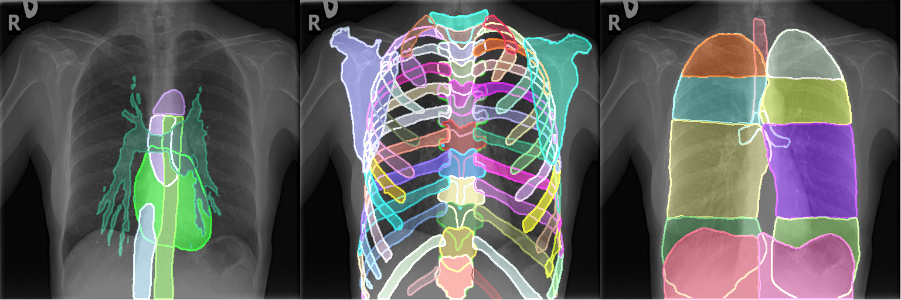

<p align="center">
<a href=https://arxiv.org/abs/2306.03934></a>
<a href=https://pepy.tech/project/cxas></a>
<a href="https://drive.google.com/drive/folders/1AEJAaPTxVMx9iofY4J4f2x5gpJqE61I2?usp=sharing"></a>
<a href="https://zenodo.org/records/16920313"></a>
<a href=https://huggingface.co/spaces/cmseibold/cxas-demo></a>
</p>


# Chest X-Ray Anatomy Segmentation


This repository provides fine-grained anatomy segmentation, **named anatomical landmarks** and understandable
features of chest X-rays, frontal and lateral, with DICOM SEG and Structured Report output. Models were trained on
the [PAX-Ray++ dataset](https://zenodo.org/records/16920313).

We provide a demo with gradio on huggingface.co for Chest X-Ray [**anatomy segmentation**](https://huggingface.co/spaces/cmseibold/cxas-demo).



## Installation

The project is available in PyPI. To install run:

```
pip install cxas
```

## Usage

We provide sample python code in the following notebooks:

- 
- 
- 
- 

### Running Segmentation from terminal

Segment the anatomy of X-Ray images \(.jpg,.png,.dcm\) and store the results \(npy,json,jpg,png,dicom-seg\):

```
cxas_segment -i {desired input directory or file} -o {desired output directory}
```

<details>
<summary>Setting options</summary>
    
- "-i"/"--input" : Either path to file or to directory to be processed. [**required**]
    
- "-o"/"--output": Output directory for segmentation masks  [**required**]
    
- "-ot"/"--output_type": Designates the storage type of segmentations if they are stored. [default = 'png']
                          choices=["json", "npy", "npz", "jpg", "png", "dicom-seg"]
    
- "-g"/"--gpus": Select specific GPU/CPU to process the input. [default = "0"]
    
- "-m"/"--model": Select Model used for inference. [default="UNet_ResNet50_default"]
                  choices=["UNet_ResNet50_default"]    
    
    
</details>

### Running Feature Extraction from terminal

Extract anatomical features from X-Ray images \(.jpg,.png,.dcm\) and store the results \(.csv\):

```
cxas_feat_extract -i {desired input directory or file} -o {desired output directory} -f {desired features to extract}
```

<details>
<summary>Setting options</summary>
    
- "-i"/"--input" : Either path to file or to directory to be processed. [**required**]
    
- "-o"/"--output": Output directory for segmentation masks  [**required**]
    
- "-f", "--feature": Select which features are supposed to be extracted. [**required**]
    
                     choices = ["SCD", "CTR", "Spine-Center Distance","Cardio-Thoracic Ratio"]
    
- "-ot"/"--output_type": Designates the storage type of segmentations if they are stored. [default = 'png']
                          choices=["json", "npy", "npz", "jpg", "png", "dicom-seg"]
    
- "-g"/"--gpus": Select specific GPU/CPU to process the input. [default = "0"]
    
- "-m"/"--model": Select Model used for inference. [default="UNet_ResNet50_default"]
                  choices=["UNet_ResNet50_default"]     
    
- "-s"/"--store_seg": "Wether to also store segmentation masks" [default = False]   
    
</details>

### Running either from terminal

Extract anatomical features from X-Ray images \(.jpg,.png,.dcm\) and store the results \(.csv\):

```
cxas -i {desired input directory or file} -o {desired output directory} -mode {"segment" or "exract"} -f {required if mode == 'extract'}
```

<details>
<summary>Setting options</summary>

- "-i"/"--input" : Either path to file or to directory to be processed. [**required**]

- "-o"/"--output": Output directory for segmentation masks  [**required**]

- "--mode": Select whether to segment images or extract features. [default="segment"]
            choices=["segment", 'extract']

- "-f", "--feature": Select which features are supposed to be extracted.
                     choices = ["SCD", "CTR", "Spine-Center Distance","Cardio-Thoracic Ratio"]

- "-ot"/"--output_type": Designates the storage type of segmentations if they are stored. [default = 'png']
                          choices=["json", "npy", "npz", "jpg", "png", "dicom-seg"]

- "-g"/"--gpus": Select specific GPU/CPU to process the input. [default = "0"]

- "-m"/"--model": Select Model used for inference. [default="UNet_ResNet50_default"]
                  choices=["UNet_ResNet50_default"]

- "-s"/"--store_seg": "Wether to also store segmentation masks" [default = False]

</details>

### Running Registration from terminal

Register chest X-ray images using landmark-based affine registration. The registration uses T4 and T10 vertebrae as landmarks and includes automatic orientation/color correction.

```
cxas_register -i {input image or directory} -o {output directory}
```

<details>
<summary>Setting options</summary>

- "-i"/"--input" : Either path to file or to directory to be processed. [**required**]

- "-o"/"--output": Output directory for registered images  [**required**]

- "-r"/"--reference": Path to reference image, directory, or .npz file. Uses default reference if not specified. [default = None]

- "-g"/"--gpus": Select specific GPU/CPU to process the input. [default = "0"]

- "-m"/"--model": Select Model used for inference. [default="UNet_ResNet50_default"]
                  choices=["UNet_ResNet50_default"]

- "--no-correction": Skip automatic orientation/color correction. [default = False]

- "--save-mask": Save the registered segmentation mask as .npy file. [default = False]

- "--build-reference": Build a reference from input images instead of registering. [default = False]

- "--reference-out": Output path for built reference .npz file. [default = "reference_features.npz"]

</details>

**Output files:**
- `{name}_registered.png` - The registered image
- `{name}_metadata.json` - Transformation metadata (rotation, scale, translation, landmarks)
- `{name}_affine.txt` - 2x3 affine transformation matrix
- `{name}_registered_mask.npy` - Registered segmentation mask (if `--save-mask` is used)

**Building a custom reference:**
```bash
cxas_register --build-reference -i reference_images/ --reference-out my_reference.npz -g cpu
```

### Python API for Registration

```python
from cxas import CXAS
from cxas.registration import Registrator
from cxas.file_io import FileLoader

# Initialize model and registrator
model = CXAS(model_name="UNet_ResNet50_default", gpus="0")
registrator = Registrator(model, reference_path=None, do_correction=True)

# Register a single image
file_dict = FileLoader().load_file("image.jpg")
result = registrator.register_single(file_dict, save_mask=True)

# Access results
registered_image = result.registered_image  # (H, W, C) numpy array
affine_matrix = result.affine_matrix        # 2x3 transformation matrix
metadata = result.metadata                   # dict with transformation details
```

## New in 0.1

- **Named anatomical landmarks.** 132 clinically curated landmarks (carina, cardiac borders, costophrenic angles,
  vertebral corners, ...) on frontal and lateral radiographs. [Details](#named-anatomical-landmarks).
- **New segmentation models** for frontal and lateral radiographs. They are sharper than the UNet, cover more
  structures and hold up better on unusual images. [Details](#anatomy-segmentation-models).
- **DICOM output that DICOM tools and the Imaging Data Commons can use.** CXAS already wrote DICOM SEG, but every
  segment was labelled "Lung, Right" and each structure went into its own file. Now one SEG holds all structures,
  plus a Structured Report with the landmarks. [Details](#dicom-in-dicom-out-imaging-data-commons--mhub).
- **Docker images that run on standard servers** (x86-64), with or without a GPU, all models included. The 2024
  images only ran on Apple-silicon Macs (arm64).

Nothing is taken away: the original UNet is still there and is still the default of `CXAS()`.

## Anatomy segmentation models

| Model | Views | Structures | Encoder | Mask resolution |
|---|---|---|---|---|
| `UNet_ResNet50_default` (default) | frontal | 159 | ResNet-50 | 512 x 512, stretched to the image |
| `M2F_anatomy_v2` | frontal | 187 | DINOv3 ViT-S/16 | the image's own resolution |
| `M2F_anatomy_v2` | lateral | 177 | RAD-DINO ViT-B/14 | the image's own resolution |

Pick the new models with `model_name="M2F_anatomy_v2"`. They return the same 159 structures as the UNet, in the
same place, so feature extraction and registration work as before. The frontal model knows a few more (the head,
the humeri, the regions below the hemidiaphragms, image quadrants, lung subdivisions); those are in
`extra_segmentation`.

CXAS picks the frontal or lateral model by itself: from the DICOM tag `ViewPosition`, or, when that is missing,
from the image (99.5% correct on 400 MIMIC-CXR radiographs).

```python
from cxas import CXAS
model = CXAS(model_name="M2F_anatomy_v2", gpus="0")   # or gpus="cpu"
pred = model.process_file("image.dcm")
pred["view"]                                 # "frontal" or "lateral"
pred["extra_segmentation"][0].keys()         # structures beyond the 159
```

## Named anatomical landmarks


<sub>Predicted landmarks, coloured by anatomical region, over the predicted mask outlines. Frontal: an unseen NIH
ChestX-ray14 radiograph (NIH Clinical Center). Lateral: a PAXRay++ test image (CT projection).</sub>

Quantitative readouts such as the cardiothoracic ratio, the costophrenic angles or device-tip positions are
defined by anatomical landmarks. CXAS predicts **132 named landmarks** (the carina, the left hemidiaphragm dome,
the cavoatrial junction, vertebral corners, ...), not points indexed along a contour. They come from
*Semantic landmark detection in chest radiographs* (Seibold, Havemann, Vinu, Fink; under review):

- **Curated definitions.** 317 candidate landmarks from the clinical literature (53 sources, 27 clinical groups)
  were rated by two reviewers with a medical background; a board-certified radiologist decided the final set of
  132 definitions, or 311 view-specific structure–landmark pairs (203 frontal, 108 lateral).
- **Geometric rules.** Each landmark is a rule on one or two anatomy masks: an extreme point in a direction, a
  contact point between structures, a point on a centerline, or a centroid. Applied to the CT-projected masks of
  PAXRay++, the rules give the training labels.
- **One model, both views.** A RAD-DINO ViT-B/14 encoder with a landmark-heatmap decoder and a mask decoder,
  trained jointly.

<details>
<summary>The 25 clinical groups (number of definitions)</summary>

Cardiothoracic ratio (4) · Costophrenic angles / sulci (15) · Cardiophrenic angles (6) · Diaphragm contour &
height (2) · Lung apex & lateral lung margin (4) · Hila (2) · Mediastinal lines & stripes (1) · Mediastinal borders &
width (3) · Aortic knob & arch (3) · Aortopulmonary window (1) · Pulmonary trunk & arteries (1) · Carina & main
bronchi (5) · Tracheal course (3) · Device-tip reference: cavoatrial junction (2) · Oesophagus, GE junction & gastric
bubble (4) · Cardiac chambers & contour (8) · Sternum (5) · Clavicles & SC/AC joints (2) · Vertebrae & spinal
alignment (16) · Ribs & rib cartilage (3) · Lung zones (region anchors) (8) · Lobes & interlobar fissures
(1) · Scapulae (positioning) (1) · Vessel centerlines (shape descriptors) (21) · Other organ centroids (11)

Definitions, rules, review outcome and literature per landmark: [`cxas/landmarks/data/landmarks.csv`](cxas/landmarks/data/landmarks.csv);
groups: [`groups.csv`](cxas/landmarks/data/groups.csv); sources: [`references.csv`](cxas/landmarks/data/references.csv).
</details>

**Python.** The view must be given (`"frontal"` or `"lateral"`); coordinates are in the input image's pixels.

```python
from cxas.landmarks import LandmarkDetector
det = LandmarkDetector(device="cuda:0")                  # or device="cpu"
lms = det.predict(image_rgb_uint8, view="frontal")
# [{"class": "trachea", "landmark": "carina", "x": 812.4, "y": 690.1, "confidence": 0.93}, ...]
lms = det.predict(image_rgb_uint8, view="frontal", min_confidence=0.1)   # drop low-confidence points
```

`det.predict_with_masks(...)` also returns the model's own mask per structure (COCO RLE).

**Command line.** `cxas_idc` predicts the landmarks along with the segmentation and writes them twice:
`landmarks_sr.dcm`, a DICOM Structured Report (TID 1500) with one POINT per landmark referencing the source image,
and `result.json`, with every landmark's class, name, pixel coordinates, confidence and an `in_sr` flag.

```bash
cxas_idc -i /data/dicom -o /data/out                      # view from DICOM, else detected
cxas_idc -i image.dcm -o out --landmark-min-confidence 0.2
cxas_idc -i image.dcm -o out --no-landmarks
```

**Confidence.** A landmark's confidence is its heatmap peak. When a structure is not visible the heatmap has no
real peak and the position is arbitrary, so landmarks below 0.1 are left out of the Structured Report by default
(about 4% on typical radiographs); `result.json` keeps all of them.

**Accuracy** (from the paper; OKS-AP with per-landmark tolerances):

| Test set | OKS-AP | PCK@0.1 |
|---|---|---|
| PAXRay++ test (CT-projected, silver labels) | 36.8 | 80.6 |
| 50 MIMIC-CXR radiographs, two readers (gold standard) | 51.1 | 76.7 |
| Reader vs. reader on the same 50 radiographs | 50.6 | 78.3 |

On the real-radiograph gold standard the model's error is close to the disagreement between two readers.
Diagnostic criteria measured on the landmarks (cardiothoracic ratio, costophrenic-angle blunting, Cobb angle,
Hoffman–Rigler sign, ...) separate report-derived labels on MIMIC-CXR better than the same criteria on the UNet's
masks. Training, the label rules and the evaluation are in
[cxr-landmarks](https://github.com/ConstantinSeibold/cxr-landmarks); CXAS contains the inference code.

## DICOM in, DICOM out (Imaging Data Commons / MHub)

`cxas_idc` reads DICOM files or whole folders and writes, for every radiograph, a folder named after the image's
SOPInstanceUID with three files:

- `seg.dcm`: one DICOM Segmentation with every structure as its own segment, at the image's own resolution
  (lossless).
- `landmarks_sr.dcm`: a DICOM Structured Report (TID 1500) with one point per landmark.
- `result.json`: the same results in plain JSON.

Both DICOM objects reference the source image, so viewers and the Imaging Data Commons can show them on top of it.

```bash
cxas_idc -i /data/dicom -o /data/out
cxas_idc -i image.dcm -o out --no-landmarks --view frontal --cxas-classes-only
```

Compared with CXAS 0.0.x, segments now carry their own name instead of "Lung, Right", all structures share one
file instead of 159, and no patient-position tags are invented for radiographs that do not have them. The older
commands (`cxas_segment ... -ot dicom-seg`) write this corrected SEG too.

`cxas_idc` uses the GPU when there is one. `pip install cxas` is all you need: the model code is part of the
package, and the weights download on first use from
[cmseibold/cxas-models](https://huggingface.co/cmseibold/cxas-models) and
[cmseibold/cxr-landmarks](https://huggingface.co/cmseibold/cxr-landmarks) (MIT). The Docker images below already
contain them.

## Docker Usage

```bash
docker build -t cxas . 
```

### For Interactive Visualization of Segmentations with Streamlit:

Run the following command to start the interactive visualization:

```bash
docker run -p 8501:8501 cseibold/cxas:interactive
```

This will launch a Streamlit app, accessible via *localhost:8501*, where you can interactively visualize segmentations.

### For DICOM processing (segmentation + landmarks, DICOM SEG / SR output):

```bash
docker run --rm --gpus all -v /path/to/dicom:/data/in:ro -v /path/to/out:/data/out cseibold/cxas:0.1.1-cu128 -i /data/in -o /data/out
docker run --rm           -v /path/to/dicom:/data/in:ro -v /path/to/out:/data/out cseibold/cxas:0.1.1-cu128 -i /data/in -o /data/out
```

Images: `cseibold/cxas:0.1.1-cu128` (also `latest`; GPUs from Turing to Blackwell, falls back to the CPU) and
`cseibold/cxas:0.1.1-cpu`, both linux/amd64 with all weights baked in (no network needed at run time). Build them
yourself with `docker/build.sh`. Weights: https://huggingface.co/cmseibold/cxas-models and
https://huggingface.co/cmseibold/cxr-landmarks (MIT).
The `cu128` image uses the GPU (Turing to Blackwell) when the container gets one (`--gpus all`) and falls back to the CPU otherwise
(`-g auto`, the default); the smaller `cpu` image is CPU-only. On CPU a radiograph takes about 6-15 s including
the landmarks and the DICOM SEG.

*The 2024 `cseibold/cxas:cli` and `:interactive` images are linux/arm64 only (they fail with `exec format error` on x86-64 hosts); use the 0.1.x images.*


## Foundation

This work builds on the following papers:

> [**Accurate Fine-Grained Segmentation of Human Anatomy in Radiographs via Volumetric Pseudo-Labeling**]()<br>
>**Purpose:** *The interpretation of chest radiographs (CXR) remains a challenge due to ambiguous overlapping structures such as the lungs, heart, and bones hindering the annotation. To address this, we propose a novel method for extracting fine-grained anatomical structures in CXR using pseudo-labeling of three-dimensional computer tomography (CTs). *

>**Methods:** *We created a large-scale dataset of 10,021 thoracic CTs, encompassing 157 labels, and applied an ensemble of 3D anatomy segmentation models to extract anatomical pseudo-labels. These labels were projected onto a two-dimensional plane, resembling CXR, enabling the training of detailed semantic segmentation models without any manual annotation effort.*

>**Results:** *Our resulting segmentation models demonstrated remarkable performance, with a high average model-annotator agreement between two radiologists with mIoU scores of 0.93 and 0.85 for frontal and lateral anatomies, whereas the inter-annotator agreement remained at 0.95 and 0.83 mIoU. Additionally, our anatomical segmentations allowed for the accurate extraction of relevant explainable medical features such as the Cardio-Thoracic-Ratio.*

>**Conclusion:** *Our method of volumetric pseudo-labeling paired with CT projection offers a promising approach for detailed anatomical segmentation of CXR with a high agreement with human annotators. This technique can have important clinical implications, particularly in the analysis of various thoracic pathologies.*

> [**Detailed Annotations of Chest X-Rays via CT Projection for Report Understanding**](https://bmvc2022.mpi-inf.mpg.de/58/)<br>
> *In clinical radiology reports, doctors capture important information about the patient's health status. They convey their observations from raw medical imaging data about the inner structures of a patient. As such, formulating reports requires medical experts to possess wide-ranging knowledge about anatomical regions with their normal, healthy appearance as well as the ability to recognize abnormalities. This explicit grasp on both the patient's anatomy and their appearance is missing in current medical image-processing systems as annotations are especially difficult to gather. This renders the models to be narrow experts e.g. for identifying specific diseases. In this work, we recover this missing link by adding human anatomy into the mix and enable the association of content in medical reports to their occurrence in associated imagery (medical phrase grounding). To exploit anatomical structures in this scenario, we present a sophisticated automatic pipeline to gather and integrate human bodily structures from computed tomography datasets, which we incorporate in our PAXRay: A Projected dataset for the segmentation of Anatomical structures in X-Ray data. Our evaluation shows that methods that take advantage of anatomical information benefit heavily in visually grounding radiologists' findings, as our anatomical segmentations allow for up to absolute 50% better grounding results on the OpenI dataset than commonly used region proposals.*


## Citation
If you use this work or dataset, please cite:
```latex
@inproceedings{Seibold_2022_BMVC,
author    = {Constantin Marc Seibold and Simon Reiß and M. Saquib Sarfraz and Matthias A. Fink and Victoria Mayer and Jan Sellner and Moon Sung Kim and Klaus H. Maier-Hein and Jens Kleesiek and Rainer Stiefelhagen},
title     = {Detailed Annotations of Chest X-Rays via CT Projection for Report Understanding},
booktitle = {33rd British Machine Vision Conference 2022, {BMVC} 2022, London, UK, November 21-24, 2022},
publisher = {{BMVA} Press},
year      = {2022},
url       = {https://bmvc2022.mpi-inf.mpg.de/0058.pdf}
}

@article{seibold2023accurate,
  title={Accurate fine-grained segmentation of human anatomy in radiographs via volumetric pseudo-labeling},
  author={Seibold, Constantin and Jaus, Alexander and Fink, Matthias A and Kim, Moon and Rei{\ss}, Simon and Herrmann, Ken and Kleesiek, Jens and Stiefelhagen, Rainer},
  journal={arXiv preprint arXiv:2306.03934},
  year={2023}
}


@misc{seibold2026landmarks,
  title  = {Semantic landmark detection in chest radiographs},
  author = {Seibold, Constantin and Havemann, Nils and Vinu, David and Fink, Matthias A.},
  note   = {Under review},
  year   = {2026}
}
```
